<!-- The cards are built from scripts/content.mjs. Edit that file and run: node scripts/build.mjs -->

  <picture>
    <source media="(max-width: 700px)" srcset="assets/header-mobile.svg">
    
  </picture>

  
  
  

 

  <picture>
    <source media="(max-width: 700px)" srcset="assets/sec-now-mobile.svg">
    
  </picture>

  
  
  
  

 

  <picture>
    <source media="(max-width: 700px)" srcset="assets/sec-work-mobile.svg">
    
  </picture>

  
  
  
  
  
  
  
  

  
    Also from 2025: <a href="https://github.com/Surya-24/Implementing-and-Analyzing--VAE-on-CelebA">β-VAE on CelebA</a> ·
    <a href="https://github.com/Surya-24/Sensor-Fusion---Particle-Filter">multi-object particle filter</a> ·
    <a href="https://github.com/Surya-24/Mastering-Blackjack-with-Reinforcement-Learning">blackjack with Q-learning and SARSA</a>
  

 

  <picture>
    <source media="(max-width: 700px)" srcset="assets/sec-how-mobile.svg">
    
  </picture>
  <picture>
    <source media="(max-width: 700px)" srcset="assets/pipeline-mobile.svg">
    
  </picture>

 

  <picture>
    <source media="(max-width: 700px)" srcset="assets/sec-kit-mobile.svg">
    
  </picture>

  
  
  
  

